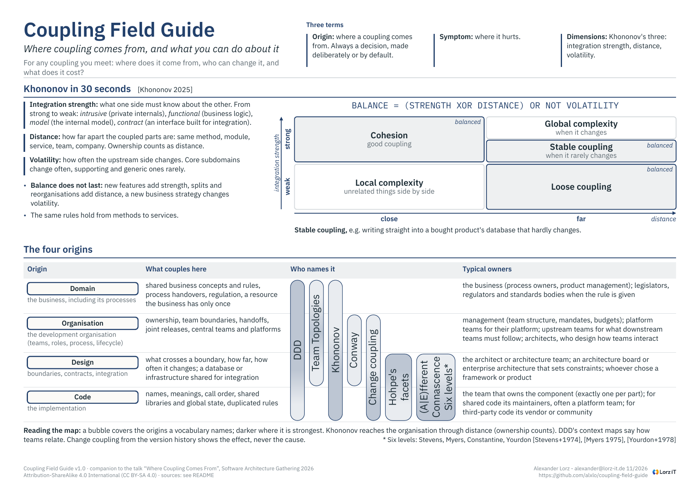
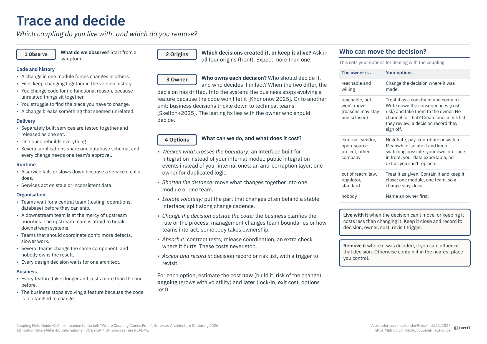

# Coupling Field Guide

*Where coupling comes from, and what you can do about it*

**Download:** [coupling-field-guide.pdf](coupling-field-guide.pdf): two pages, A4 landscape. To print it double-sided, choose *flip on short edge*.

## What it is

A two-page reference for any coupling you meet in a software system: where it comes from, who can change it, and what it costs.

- **Front:** a shared vocabulary. Three terms, Khononov's dimensions in 30 seconds with his balance rule as a formula and a chart (strength × distance, volatility splitting strong and far), and the four origins of coupling (domain, organisation, design, code) with a map of the vocabularies that name the coupling in each, and the owners typical for each.
- **Back:** *Trace and decide.* Four questions that lead from a symptom (17 symptoms in five groups) to the decisions behind it and their owners, the options for dealing with the coupling, and what each option costs.

It is the companion to the talk *Where Coupling Comes From* at the Software Architecture Gathering 2026.

## Talk slides

**Download:** [talk/2026-11-18_SAG_Alexander_Lorz_Where_Coupling_Comes_From.pdf](talk/2026-11-18_SAG_Alexander_Lorz_Where_Coupling_Comes_From.pdf): the slides of the talk *Where Coupling Comes From: A Working Model Across Domain, Design, Code, and Organisation*, Software Architecture Gathering 2026, Berlin, 18 November 2026 (42 slides, no speaker notes).

**Cite the talk as:**

> [Lorz 2026] A. Lorz, "Where Coupling Comes From: A Working Model Across Domain, Design, Code, and Organisation," presented at Software Architecture Gathering 2026, Berlin, Germany, Nov. 18, 2026. [Online]. Available: <https://github.com/alxlo/coupling-field-guide/blob/main/talk/2026-11-18_SAG_Alexander_Lorz_Where_Coupling_Comes_From.pdf>

Licence of the slides: CC BY-SA 4.0, except quotations and third-party images; details in [licenses/SLIDES-NOTICE.md](licenses/SLIDES-NOTICE.md).

## How to use it

1. Start from a symptom you observe (back).
2. Ask in all four origins (front) which decisions created the coupling or keep it alive. Expect more than one.
3. For each decision, find out who should decide it and who decides it in fact.
4. Choose an option by what the owner's reach allows, and estimate its cost now, ongoing and later (back).

## Files

| File | Content |
|---|---|
| `coupling-field-guide.svg` | The master, edited in [Inkscape](https://inkscape.org) (1.4 or later; two pages). Needs the fonts IBM Plex Sans and IBM Plex Mono |
| `coupling-field-guide.pdf` | Exported from the SVG, for download and print |
| `coupling-field-guide.png` | Front page preview |
| `coupling-field-guide-back.png` | Back page preview |
| `coupling-field-guide.md` | The text of both pages |
| `talk/2026-11-18_SAG_Alexander_Lorz_Where_Coupling_Comes_From.pdf` | Slides of the talk (SAG 2026) |

## Sources

The guide prints no source list, to keep it short. Inline keys such as [Khononov 2025] and the content of both pages rest on these sources:

- [Cataldo+2013] M. Cataldo and J. D. Herbsleb, "Coordination breakdowns and their impact on development productivity and software failures," _IEEE Transactions on Software Engineering_, vol. 39, no. 3, pp. 343–360, Mar. 2013, doi: 10.1109/TSE.2012.32.
- [Conway 1968] M. E. Conway, "How do committees invent?," _Datamation_, pp. 28–31, Apr. 1968. [Online]. Available: <https://www.melconway.com/Home/Committees_Paper.html>
- [Evans 2015] E. Evans, _Domain-Driven Design Reference: Definitions and Pattern Summaries_. Domain Language, Inc., 2015. [Online]. Available: <https://domainlanguage.com/wp-content/uploads/2016/05/DDD_Reference_2015-03.pdf>
- [Hohpe 2024b] G. Hohpe, "The Many Facets of Coupling," _Gregor's Ramblings_, Jun. 2024. [Online]. Available: <https://www.enterpriseintegrationpatterns.com/ramblings/coupling_facets.html>
- [iSAQB FLC 2025] iSAQB e.V., _Curriculum for Certified Professional for Software Architecture (CPSA)®: Foundation Level_, Version 2025.1-rev2-EN, iSAQB e.V., 2025. [Online]. Available: <https://github.com/isaqb-org/curriculum-foundation/releases/tag/2025.1-rev2>
- [Khononov 2025] V. Khononov, _Balancing Coupling in Software Design: Universal Design Principles for Architecting Modular Software Systems_. Hoboken, NJ, USA: Addison-Wesley, 2025.
- [Myers 1975] G. J. Myers, _Reliable Software Through Composite Design_. New York, NY, USA: Petrocelli/Charter, 1975.
- [Richards+2020] M. Richards and N. Ford, _Fundamentals of Software Architecture: An Engineering Approach_, O'Reilly, 2020.
- [SE Radio 615] Software Engineering Radio, "SE Radio 615: Kent Beck on ‘Tidy First?’," May 2024. [Online]. Available: <https://se-radio.net/2024/05/se-radio-615-kent-beck-on-tidy-first/>
- [SE Radio 662] Software Engineering Radio, "SE Radio 662: Vlad Khononov on Balancing Coupling in Software Design," Apr. 2025. [Online]. Available: <https://se-radio.net/2025/04/se-radio-662-vlad-khononov-on-balancing-coupling-in-software-design/>
- [Skelton+2025] M. Skelton and M. Pais, _Team Topologies: Organizing Business and Technology for Fast Flow of Value_, 2nd ed. Portland, OR, USA: IT Revolution Press, 2025.
- [Starke 2024] G. Starke, _Effektive Software-Architekturen: Ein praktischer Leitfaden_ (in German), 10th ed. Munich, Germany: Carl Hanser Verlag, 2024. Website: <https://esabuch.de>
- [Stevens+1974] W. P. Stevens, G. J. Myers, and L. L. Constantine, "Structured design," _IBM Systems Journal_, vol. 13, no. 2, pp. 115–139, 1974, doi: 10.1147/sj.132.0115.
- [Yourdon+1978] E. Yourdon and L. L. Constantine, _Structured Design: Fundamentals of a Discipline of Computer Program and Systems Design_, 2nd ed., Yourdon Press, 1978.
- [Zimmermann+2004] T. Zimmermann, P. Weißgerber, S. Diehl, and A. Zeller, "Mining version histories to guide software changes," in _Proc. International Conference on Software Engineering (ICSE)_, Edinburgh, UK, May 2004.

## Author and version

Alexander Lorz, Lorz iT. Version 1.0, November 2026.

Made together with an AI assistant (Claude by Anthropic). Who did what, and who is responsible: [AI-DISCLAIMER.md](AI-DISCLAIMER.md).

Corrections and suggestions are welcome as [issues](https://github.com/alxlo/coupling-field-guide/issues).

## License

[CC BY-SA 4.0](https://creativecommons.org/licenses/by-sa/4.0/) (`licenses/CC-BY-SA-4.0.txt`).
The PDF embeds IBM Plex Sans and IBM Plex Mono, © IBM Corp., under the [SIL Open Font License 1.1](https://openfontlicense.org) (`licenses/IBM-Plex-OFL.txt`).

The talk slides (`talk/`) are under CC BY-SA 4.0 as well, **except** quotations, the NASA cover photo, AI-generated images and embedded fonts: see [licenses/SLIDES-NOTICE.md](licenses/SLIDES-NOTICE.md).
